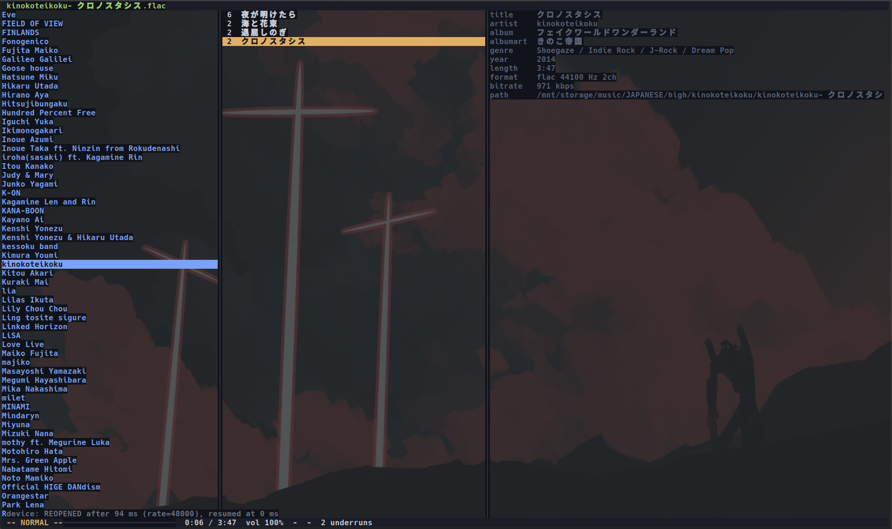
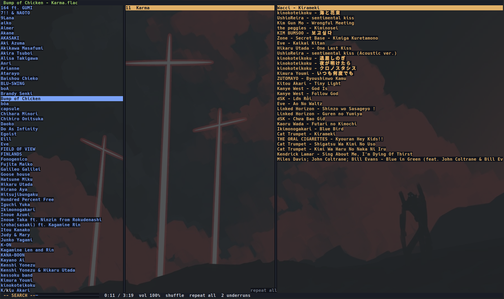
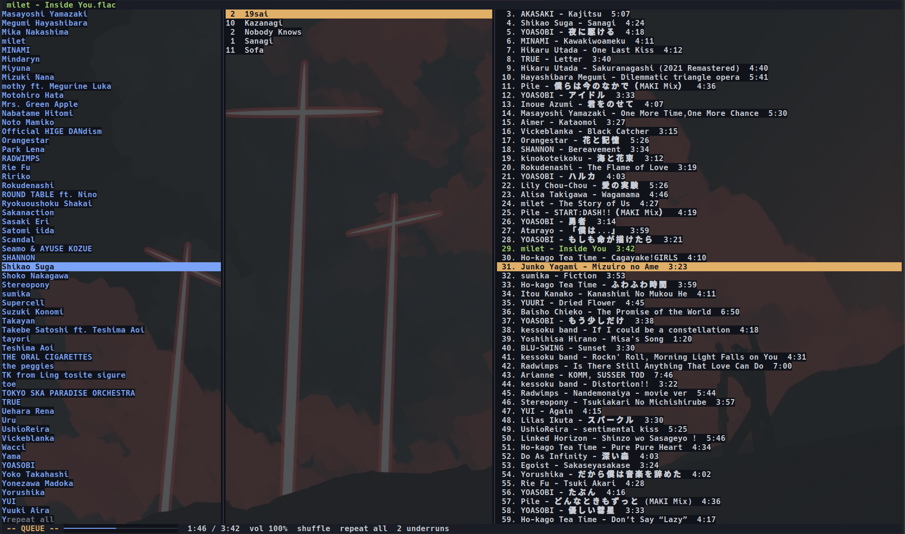
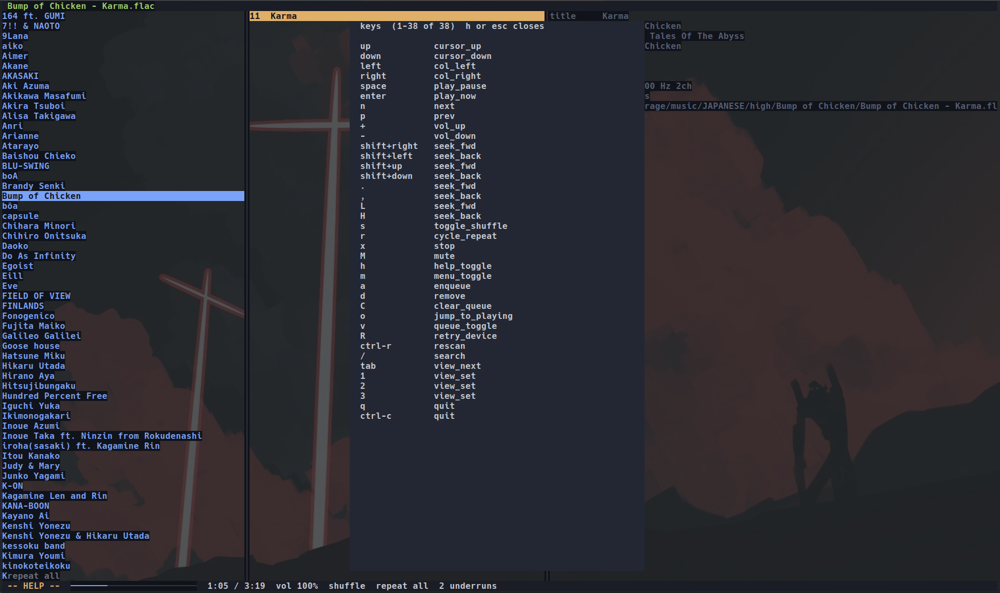

# kurono

A simple, local terminal music player in C.

`kurono` is standalone. It decodes and plays audio itself, no daemon, no MPD protocol, no client/server split, no other player wrapped underneath. One process, one binary, keyboard driven throughout. It indexes your music tree into SQLite and gives you a three-column [ranger](https://github.com/ranger/ranger)-style browser over it, with gapless playback and full-text search.

Linux only, deliberately.



---

## Features

* **Three-column browsing.** Artists, albums, tracks, or directories, if you'd rather see the tree as it is on disk. Same widget, different query.
* **Gapless playback.** The next track is opened and decoding before the current one ends. No silence at album boundaries, no click.
* **Full-text search** over your whole library through SQLite's FTS5, ranked, updating as you type.
* **A real queue** you can reorder and edit while it plays, in a pane that keeps the transport keys live.
* **Instant rescans.** The first scan reads tags from every file; after that `kurono` compares size and mtime and skips everything unchanged.
* **Multiple music roots**, so an archive disk and a home directory can be one library.
* **Shuffle and repeat** off, all, one.
* **Truecolor themed**, with every colour behind a named slot rather than hardcoded in the drawing code.
* **Fast and small.** No runtime, no garbage collector, no config parsing on the hot path. Playback runs lock-free.



---

## How it works

Three threads, and the split between them is the whole design.

**The UI thread** owns the terminal and nothing else. It waits in `epoll` on four things at once: your keystrokes, window resizes and signals via `signalfd`, a repaint timer via `timerfd`, and a pipe the audio engine writes to. It never blocks on audio, so the interface stays responsive while a track is opening, a disk is spinning up, or a scan is running.

**The decoder thread** runs ffmpeg: demux, decode, resample to one session format, and push the resulting float frames into a ring buffer. It works about two seconds ahead of what you're hearing.

**The audio callback** is the one the sound card drives, and it is the reason the rest is shaped this way. It runs on a deadline measured in milliseconds, miss it and you hear a click. So it never allocates, never takes a lock, never makes a system call, and never waits for anything. It pops frames from the ring, applies the volume, copies a block off for the visualiser, and returns. When the decoder hasn't kept up it plays silence rather than blocking, and records the fact for later.

The ring between them is single-producer, single-consumer and lock-free: one atomic load and one atomic store per crossing, no mutex anywhere in the audio path. Playback position comes from counting frames actually consumed by the sound card, never from asking the decoder, because the decoder is always two seconds into the future.

**The library** is a SQLite database in your cache directory, built by walking the music tree with `taglib`. It's a derived cache and nothing else, it is never written inside your music directory, and if it is ever corrupted or points at a different music root, `kurono` deletes it and rebuilds. Your files are treated as read-only, with the playlist directory as the sole exception.

---

## Requirements

* Linux, `gcc`, GNU `make`, `pkg-config`
* ffmpeg 5.1 or newer, SQLite 3, TagLib

| Library | Purpose |
|---|---|
| ffmpeg ≥ 5.1 (`libavformat`, `libavcodec`, `libavutil`, `libswresample`) | Demux, decode, resample |
| `sqlite3` | Library index and FTS5 search |
| `taglib_c` | Tag reading during the scan |

Two more are vendored into `vendor/` as single headers, so there's nothing to install for them:

| File | Pinned at | Purpose |
|---|---|---|
| `vendor/miniaudio.h` | [`0.11.25`](https://github.com/mackron/miniaudio/blob/0.11.25/miniaudio.h) | Device output (PipeWire / PulseAudio / ALSA / JACK) |
| `vendor/termbox2.h` | [`v2.5.0`](https://github.com/termbox/termbox2/blob/v2.5.0/termbox2.h) | Terminal rendering |

Vendored headers are never edited, upgrades are wholesale replacements at a new pin.

---

## Install

**Fedora:**

```bash
sudo dnf install gcc make pkgconf-pkg-config \
                 libavformat-free-devel libavcodec-free-devel \
                 libavutil-free-devel libswresample-free-devel \
                 sqlite-devel taglib-devel
```

**Debian / Ubuntu:**

```bash
sudo apt install build-essential pkg-config \
                 libavformat-dev libavcodec-dev libavutil-dev \
                 libswresample-dev libsqlite3-dev libtag1-dev
```

**Arch:**

```bash
sudo pacman -S base-devel ffmpeg sqlite taglib
```

**Then build and install:**

```bash
git clone git@gitlab.com:tri282/kurono.git
cd kurono
make install
```

That installs to `~/.local/bin`, so it needs no `sudo`. Check it worked:

```bash
cd ~ && kurono --version
```

If your shell says `kurono: command not found`, `~/.local/bin` isn't on your `PATH`:

```bash
echo 'export PATH="$HOME/.local/bin:$PATH"' >> ~/.bashrc && source ~/.bashrc
```

To build without installing, just `make`, and run `./kurono` from the repo. To remove it, `make uninstall`.

**If the build can't find a library**, check what `pkg-config` sees, it is the single source of truth here, and the `Makefile` never hardcodes library or include paths:

```bash
pkg-config --modversion libavformat libavcodec libavutil libswresample sqlite3 taglib_c
```

Six version strings and no errors means you're set. Anything missing prints `No package 'X' found` and names exactly what's absent.

> **ffmpeg 5.1 is a hard floor.** `AVChannelLayout` arrived in 5.1, and there's no compatibility shim. Fedora 38+, Debian 13, Ubuntu 24.04+ and current Arch are all fine. Ubuntu 22.04 ships ffmpeg 4.4 and will not build.

> **On Fedora, install the four `lib*-free-devel` packages listed above, not `ffmpeg-free-devel`**, that one is a metapackage pulling in three more devel packages `kurono` doesn't use. And if you have RPM Fusion enabled, don't install its `ffmpeg-devel`: it also provides `pkgconfig(libavformat)`, it mismatches the `ffmpeg-free` runtime libraries already on a stock Fedora system, and whichever registered last is the one `pkg-config` will hand you. Verify with `pkg-config --modversion libavformat` and check it reports a `-free` build.

---

## Configuration

Everything is environment variables today. A config file is coming in v2; `KURONO_CONFIG` is already reserved for it.

| Variable | Default | Purpose |
|---|---|---|
| `KURONO_MUSIC_DIR` | `$XDG_MUSIC_DIR`, then `~/Music` | Roots of the music tree, traversed recursively. `:`-separated for more than one |
| `KURONO_IGNORE_DIRS` | unset | Comma-separated directory names never descended into |
| `KURONO_PLAYLIST_DIR` | first music root + `/playlists` | Where playlists are read from and written to |
| `KURONO_NO_SCAN` | unset | If set, skip the startup scan entirely |
| `KURONO_TRACE` | unset | If set to `1`, write an audio-path trace log to `$XDG_STATE_HOME/kurono/trace.log` |
| `KURONO_CONFIG` | `$XDG_CONFIG_HOME/kurono/config.toml` | Reserved. Unused today. |

**Point it at your music:**

```bash
export KURONO_MUSIC_DIR="$HOME/Music"
```

**More than one location**, separate them with `:`, as in `PATH`:

```bash
export KURONO_MUSIC_DIR="$HOME/Music:/mnt/archive/flac"
```

Roots are scanned in order, and that's the order they appear in the Directory view. A root that doesn't exist is reported rather than quietly skipped, so an unmounted disk looks like an unmounted disk instead of an empty library. A directory whose name contains `:` can't be used, the same limitation `PATH` has.

Symlinking a second location into your music directory does **not** work: the scanner skips symlinked directories deliberately, so it can't escape the tree it was pointed at. Use multiple roots instead.

**Skip directories by name:**

```bashv
export KURONO_IGNORE_DIRS=".stversions,.Trash-1000"
```

These are matched against a directory's own name, anywhere in the tree, exactly and case-sensitively. Not paths, not patterns, `.Trash-1000` matches, `.Trash-*` and `/mnt/music/.Trash-1000` match nothing. An ignored directory is never descended into, so its whole subtree is skipped rather than scanned and filtered.

The index lives at `$XDG_CACHE_HOME/kurono/library.db`, falling back to `~/.cache/kurono/library.db`. Deleting it is always safe, the next launch rebuilds it.

**Something wrong?** `kurono --paths` prints the music roots, database path and playlist directory it actually resolved, then exits. That's the first thing to run when the wrong tree is being indexed.

---

## Usage

Run `kurono`. On first launch it scans your music tree and builds the index, printing progress before the interface starts. Every launch after that skips everything unchanged, which usually makes it instant.

### Layout

```txt
+--------------------------------------------------------------+
| header: now playing / mode indicators                        |
+---------------+----------------+-----------------------------+
| column 1      | column 2       | column 3                    |
| artists       | albums         | tracks                      |
| (or dirs)     | (or entries)   | (or preview)                |
+---------------+----------------+-----------------------------+
| -- NORMAL -- | progress, time, volume, shuffle, repeat       |
+--------------------------------------------------------------+
```

The leftmost field of the status bar is the current input mode, `vim`-style. It reads `-- NORMAL --` while browsing, and changes to `-- SEARCH --`, `-- HELP --` or `-- MENU --` while one of those is open.

Directory, Artists and Album Artists are the same browser fed by different queries, not separate screens, which is why they behave identically.



### Keybindings

Arrows navigate, letters act. Every key resolves through a table to a named action, which is what will make them remappable from a config file without touching the input path.

| Key | Action |
|---|---|
| `↑` / `↓` | Move up / down within a column |
| `←` / `→` | Move between columns |
| `space` | Play / pause |
| `enter` | Play the selection now |
| `a` | Add the selection to the queue |
| `d` | Remove from the queue |
| `C` | Clear the queue |
| `v` | Open / close the queue pane |
| `K` / `J` | Move an entry up / down (queue pane) |
| `o` | Jump to the playing track |
| `n` / `p` | Next / previous track |
| `x` | Stop |
| `shift+←` / `shift+→` | Seek 5 s back / forward |
| `shift+↓` / `shift+↑` | Seek 30 s back / forward |
| `,` / `.` | Seek 5 s back / forward (fallback) |
| `H` / `L` | Seek 30 s back / forward (fallback) |
| `+` / `-` | Volume up / down |
| `M` | Mute / unmute |
| `/` | Search |
| `s` | Toggle shuffle |
| `r` | Cycle repeat, off, all, one |
| `tab` | Cycle view |
| `1` / `2` / `3` | Directories / Artists / Album Artists |
| `ctrl+r` | Rescan the library |
| `R` | Retry the audio device after a loss |
| `h` | Help, the key list, generated from the bindings themselves |
| `m` | Settings menu |
| `esc` | Close the open overlay or cancel a search |
| `q` / `ctrl+c` | Close the open overlay, or quit when none is open |

*The queue pane is a mode of its own. While it's open the arrows move its cursor rather than the browser's, `enter` plays the entry under it, and `d` `C` `K` `J` edit it. Transport, play/pause, seek, volume, mute, next/previous, shuffle, repeat, there too, as does rescan (`ctrl-r`). View switching (`tab`, `1`/`2`/`3`) doesn't; close the pane with `esc` or `v` first.*

`h` `j` `k` `l` are **not** navigation keys. Navigation lives on the arrows so that `h` can open help, a keymap that answered to `j`, `k` and `l` but opened a window on `h` would fail silently on the most-practised motion of the four.



### If audio drops out

Every run prints two lines on exit. The first counts underruns and dropped trace records, and says how close the decode buffer came to empty; the second says how much headroom the buffer kept during uninterrupted playback:

```txt
kurono: 0 underruns, 0 trace records dropped, pcm_ring low-water n/a
kurono: steady state 0h00m, headroom low 2.71 s of 2.73 s, 0 underruns
```

The first line's low-water is reported only when the audio thread saw the buffer fall below about 0.1 s, so `n/a` is the healthy reading. The second line's headroom is the lowest the buffer fell during uninterrupted playback, out of its capacity, with starts and seeks excluded. If no track was long enough to fill the buffer it reads `steady state none (no track filled the buffer)`.

If that shows underruns, `KURONO_TRACE=1` writes a full per-event log to `$XDG_STATE_HOME/kurono/trace.log` (falling back to `~/.local/state`). The audio thread can't format text, so it records fixed-size events that the UI thread renders later, which is why tracing costs nothing when you aren't reading it.

---

## Terminal support

Any terminal with truecolor works, `kurono` requests `TB_OUTPUT_TRUECOLOR`. The interface needs at least **60x15**; below that it draws `terminal too small` and nothing else, and picks the layout back up as soon as you resize. Three columns are comfortable from about 100 wide.

The `shift+arrow` seek bindings depend on your emulator sending `CSI 1;2X` for a modified arrow. xterm, foot, kitty, ghostty and alacritty all do, and `tmux` passes it through. If yours doesn't, `,` `.` `H` `L` are bound to the same seeks as an emulator-independent fallback.

Cover art is a v2 feature, and it'll pick a renderer by querying the terminal at runtime rather than trusting `$TERM`:

| Terminal | Kitty graphics | Sixel | Renderer |
|---|---|---|---|
| kitty | yes | no | kitty protocol |
| ghostty | yes | yes | kitty protocol |
| Konsole | no | yes | sixel |
| foot | no | yes | sixel |
| alacritty | no | no | halfblock |

Halfblock always works and is the fallback whenever detection is inconclusive. Both graphics protocols need passthrough sequences under `tmux` and behave inconsistently there, so `kurono` drops to halfblock when it detects `tmux`.

*If a crash ever leaves your terminal in raw mode with the alternate screen active, run `reset`.*

---

## Building

```bash
make            # default build, debug symbols, no optimization
make release    # -O2 -DNDEBUG, what `make install` uses
make clean
```

### Build targets

| Target | Flags | Use |
|---|---|---|
| `make` | `-g` | Default. Debug symbols, no optimization. |
| `make release` | `-O2 -DNDEBUG` | Optimized, assertions stripped. What `install` uses. |
| `make debug` | `-Og -fno-omit-frame-pointer` | Readable stack traces under a debugger. |
| `make asan` | `-fsanitize=address,undefined` | Memory error detection. |
| `make tsan` | `-fsanitize=thread` | Data race detection. The important one here. |
| `make clean` | | Remove objects, dependency files and binaries. |
| `make install` | | Build `release` and install to `$PREFIX/bin` (default `~/.local/bin`). |
| `make check` | | The three grep-based invariants: `check-layering`, `check-flush`, `check-theme`. |
| `make analyze` | | `-fanalyzer` over every source. Produces no binary. |
| `make ring-stress` | `-fsanitize=thread` | Build `tools/ring_stress`, the SPSC producer/consumer harness. |
| `make queue-test` | | Build `tools/queue_test`. |
| `make keymap-test` | | Build `tools/keymap_test`. |
| `make testsrc-test` | | Build `tools/testsrc_test`. |
| `make fts-query-test` | | Build `tools/fts_query_test`. Links `sqlite3` for the real FTS5 parser. |
| `make nullsink-test` | `-fsanitize=thread` | Build `tools/nullsink_test`, which drives the playback callback from a timer thread with no audio device. |
| `make gapless-test` | | Build `tools/gapless_test`, which checks that short lossy files decode to exactly their original length. Links the ffmpeg libraries. |

Object files carry `-MMD -MP`, so editing a header rebuilds exactly the translation units that include it. The `.d` files live under `build/` and are removed by `clean`.

`asan` and `tsan` are mutually exclusive builds, they use separate object trees, so switching between them needs no `clean`.

### Command-line flags

`kurono` with no arguments is the player. Everything else is diagnostic.

| Flag | Does |
|---|---|
| `--version` | Print the version and exit. |
| `--paths` | Print the resolved music roots, database path and playlist directory, then exit. |
| `--scan` | Scan and index the music tree, then exit. No TUI, no device. |
| `--play FILE` | Play one file headless, a real sink and decoder through the engine, no terminal UI. |
| `--play FILE --seek MS` | The same, seeking once to `MS` as soon as the track is open. |
| `--play FILE --seek-stress N` | `N` randomised seeks in a row. The flush-handshake driver, and what to run under `make tsan`. |
| `--play FILE --seek-paused MS` | Seek while paused, the case where the ring and the device disagree about what has been consumed. |
| `--play FILE --null-sink [...]` | Run the same diagnostics with no audio device: a timer thread stands in for the sound card. Combines with `--seek`, `--seek-stress` and `--seek-paused`. At exit it prints a frame-accounting and a pacing verdict, and fails if either is off. |
| `--play FILE --null-sink --fault MS` | Simulate a decode error `MS` milliseconds in, using a synthetic source in place of `FILE` (required but ignored). Checks that a failing track is reported and skipped rather than fatal. |

### Notes for contributors

`CFLAGS` includes `-D_POSIX_C_SOURCE=200809L`, which is not optional: under strict `-std=c11` the POSIX `strdup` is undeclared, gcc then assumes it returns `int`, and the pointer is truncated on 64-bit builds.

Every target must pass `-DTB_OPT_ATTR_W=32` when compiling the translation unit that includes `vendor/termbox2.h`. `termbox2` defaults it to 16, which silently drops truecolor. `ui/tui.c` carries a `_Static_assert` on it so a dropped flag is a build failure rather than a degraded runtime.

### Project layout

```txt
kurono/
├── src/
│   ├── main.c              startup, config load, thread spawn, teardown
│   ├── event.c             epoll loop over tty/signal/timer/engine fds
│   ├── config.c            env var resolution, XDG paths
│   ├── queue.c             playback queue: order, shuffle, repeat
│   ├── audio/              engine, ring buffer, decoder, sink, test sources
│   ├── library/            sqlite index, filesystem scan, queries
│   └── ui/                 tui, theme, keymap, browser, queue view, status bar
├── include/                mirrors src/, one header per source file
├── tools/                  standalone test binaries and harnesses
├── vendor/                 single-header third-party, never edited
└── Makefile
```

`tools/` holds the parts pure enough to test without a device, a terminal or any music: `ring_stress` (the SPSC ring under TSan), `queue_test`, `keymap_test`, `testsrc_test`, `fts_query_test`, `nullsink_test` and `gapless_test`. Most link against exactly the one source file they exercise; `keymap_test`, `fts_query_test`, `nullsink_test` and `gapless_test` need a few more. `gapless_test` decodes the files in `tools/fixtures/`, which `tools/gen_fixtures.sh` regenerates with the `ffmpeg` command-line tool; CI uses the committed files.

Third-party use is confined on purpose, all ffmpeg lives in `audio/decoder.c`, all miniaudio in `audio/sink.c`, all SQLite in `library/db.c`, all termbox2 in `ui/tui.c`. `ui/` may call `library/` and `audio/`; neither ever calls back into `ui/`, they emit events instead. `make check` enforces this with grep, so a violation fails the build rather than being noticed in review.

---

## Releases

Tagged releases carry a source tarball and its SHA-256 checksum. `kurono`
links dynamically, so there is no prebuilt binary — a binary would run only on
a distro with matching library versions. Build from source, or wait for a
package.

See [`CHANGELOG.md`](CHANGELOG.md) for what changed in each release.

CI builds and tests every tag on both Fedora and Debian. It cannot run
`kurono` itself — there is no audio device and no pty in a container — so a
green pipeline covers the compile, the invariants, `-fanalyzer` and the seven
standalone test binaries, but not the player. The interface and the audio path
are verified by hand under ThreadSanitizer and AddressSanitizer before a
release.

---

## License

Copyright (C) 2026 Tri Minh Do.

`kurono` is free software under the **GNU General Public License, version 3 or
later**. See [`LICENSE`](LICENSE) for the full text.

You may run, study, modify and share it freely. If you distribute a modified
version, you must publish your source under the same terms, using it
privately, however you like, carries no obligation.

Third-party components and their own terms are listed in
[`THIRD-PARTY.md`](THIRD-PARTY.md). An LGPL or GPL build of ffmpeg are both
compatible with `kurono`'s licence; Fedora's `libav*-free` packages are a GPL
build.

---

## Status

v1 is complete and what's described above works. **v2 is underway**, cover art, a spectrum visualiser, playlists, a config file, an EQ, and moving the scan to the background.
